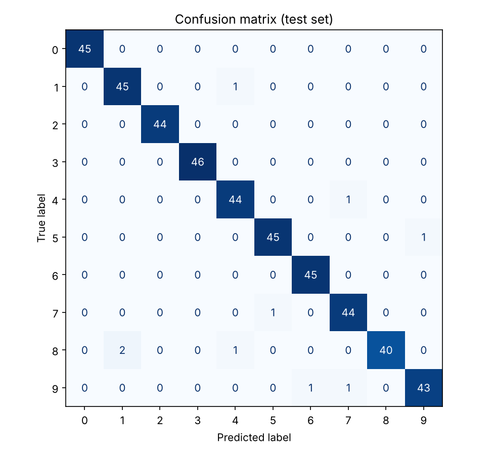
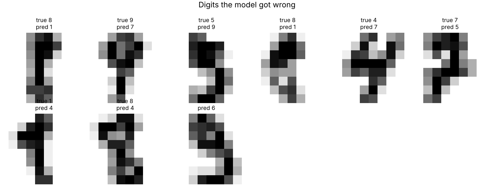

# Digit Lab

Compares four machine-learning classifiers on handwritten digits, picks the best using cross-validation, and reports honest results on data it never trained on.

Built with scikit-learn on the 1,797-image digits dataset that ships with the library, so there is nothing to download.

## Run it

```bash
python -m venv .venv
source .venv/bin/activate        # Windows: .venv\Scripts\activate
pip install -r requirements.txt
python -m digitlab.train
```

This writes the trained model, a confusion matrix, an image of the mistakes and a `results.json` to `artifacts/`.

## Results

5-fold cross-validation on the training set (75% of the data):

| Model | Accuracy |
| --- | --- |
| SVM (RBF kernel) | 0.979 +/- 0.006 |
| Random forest | 0.978 +/- 0.011 |
| k-nearest neighbors | 0.973 +/- 0.004 |
| Logistic regression | 0.966 +/- 0.010 |

The SVM won, and scored **98.0% accuracy on the held-out 25% test set** (450 images the model never saw during training or model selection).



Only 9 of the 450 test images were misclassified, spread across different digit pairs with no single dominant confusion. Here they are:



## Method

- **Stratified split**, so every digit appears in training and test in the same proportion
- **Model selection uses cross-validation on the training set only.** The test set is touched once, at the end, so the final number is not inflated by choosing the winner on it.
- **Scaling lives inside a pipeline**, so it is fit on training folds only and does not leak information from the validation fold
- **Everything is seeded**, so results are reproducible

## Project layout

```
digitlab/pipeline.py   Data loading, candidate models, cross-validated comparison.
digitlab/train.py      Training, evaluation, plots and saving the model.
tests/                 Split, ranking and an end-to-end train-and-save test.
```

## Use the saved model

```python
import joblib
from sklearn.datasets import load_digits

model = joblib.load("artifacts/model.joblib")
digits = load_digits()
print(model.predict(digits.data[:5]), digits.target[:5])
```

## Tests

```bash
python -m unittest discover -v
```

## Caveats and next steps

- The digits are tiny (8x8), so 98% here is not comparable to results on full-size MNIST
- Hyperparameters are set by hand. A grid search (`GridSearchCV`) is the obvious next step.
- A small web page where you draw a digit and get a prediction would make a great demo
